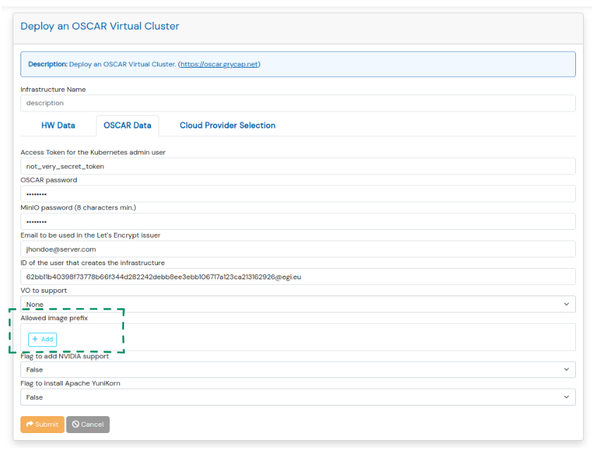

# Additional configuration

To configure trusted image origins, OSCAR reads the `allowed_image_repositories` JSON array from an additional ConfigMap. Each entry must be a fully qualified registry and repository path (for example, `ghcr.io/grycap`). OSCAR compares the registry and complete repository path components, not substrings: `ghcr.io/grycap` permits `ghcr.io/grycap/imagemagick` (including tags and digests) but **not** `ghcr.io/grycap-other/image` or `other.example/ghcr.io/grycap/image`. A more specific entry such as `ghcr.io/grycap/imagemagick` permits that image and its subpaths, but not `ghcr.io/grycap/imagemagick-other`.

If the ConfigMap is absent or the array is empty (`[]`), images are unrestricted. If the ConfigMap exists but its policy cannot be read or parsed, service creation and updates fail instead of silently disabling the restriction. Malformed entries in an existing ConfigMap are skipped with a warning, so a single invalid entry does not block services that match other valid entries. If the policy does not contain any valid entry, service creation is not blocked and the restriction is effectively disabled (a warning is logged).

```yaml
apiVersion: v1
kind: ConfigMap
metadata:
  name: config.yaml
  namespace: oscar
data:
  allowed_image_repositories: '["ghcr.io/grycap"]'
```

The administrator can also update the policy using `PUT /system/config` with Basic authentication. The endpoint validates that every entry is a fully qualified registry and repository path and rejects the request with a `400` listing the malformed entries (for example, `test` or `test/test` fail because strict validation requires the registry to be explicitly defined). This example allows images from the `ghcr.io/grycap` owner only:

```sh
curl -X PUT -u '<admin-user>:<admin-password>' \
  -H 'Content-Type: application/json' \
  -d '{"allowed_image_repositories":["ghcr.io/grycap"]}' \
  'https://<oscar_endpoint>/system/config'
```

Additionally, this property can be added when creating an OSCAR cluster through the IM, which will automatically create the ConfigMap.



Managed volumes do not require extra entries in this additional configuration file. Volume provisioning uses the cluster storage integration already configured for OSCAR.

MinIO bucket quotas also do not require entries in this additional
configuration file. Per-user MinIO quota settings are managed through
`/system/quotas/user/{userId}` and stored by OSCAR in each user's namespace.

## OIDC authorization groups (`OIDC_GROUPS`)

The `OIDC_GROUPS` list (inside `config.yaml`) contains the strings that a user's
token groups are matched against to grant access to OSCAR. A user is authorized
if any of their groups matches any entry in this list exactly. During the
transition to the new Keycloak entitlements of AI4EOSC, the following entry types
are supported at the same time:

- `vo.<name>`: the VO name. It matches the `group_membership` /
  `entitlements` VOs issued by EGI and the VOs derived from the new
  `eduperson_entitlement` URNs.
- `platform-access:<vo>`: legacy Keycloak realm role (for example
  `platform-access:vo.ai4eosc.eu`). It is kept as a fallback while Keycloak
  still issues realm roles alongside the new entitlements; it is scheduled for
  removal.
- `/group/name`: legacy ImGui group path.
- `ap-u` / `ap-d`: normalized AI4EOSC access levels derived from the new
  `eduperson_entitlement` claims, for example
  `urn:geant:eosc-portal.eu:group:Platform Access:vo.ai4eosc.eu:role=Access-AP-U`
  (which may arrive URL-encoded, e.g.
  `urn%3Ageant%3Aeosc-portal.eu:group:Platform%20Access:vo.ai4eosc.eu:role=Access-AP-U`).
  Only the `Access-AP-U` (`ap-u`) and `Access-AP-D` (`ap-d`) levels grant access
  to resource-consuming services such as OSCAR. Each admitted entitlement also
  contributes its VO, so the exact-match VO check on service creation keeps
  working without any change.
