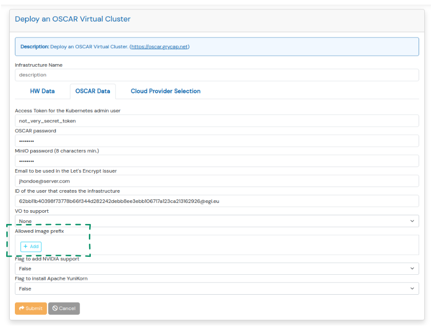

# Additional configuration

To configure trusted image origins, OSCAR reads the `allowed_image_repositories` JSON array from an additional ConfigMap. Each entry must be a fully qualified registry and repository path (for example, `ghcr.io/grycap`). OSCAR compares the registry and complete repository path components, not substrings: `ghcr.io/grycap` permits `ghcr.io/grycap/imagemagick` (including tags and digests) but **not** `ghcr.io/grycap-other/image` or `other.example/ghcr.io/grycap/image`. A more specific entry such as `ghcr.io/grycap/imagemagick` permits that image and its subpaths, but not `ghcr.io/grycap/imagemagick-other`.

If the ConfigMap is absent or the array is empty (`[]`), images are unrestricted. If the ConfigMap exists but its policy cannot be read or parsed, service creation and updates fail instead of silently disabling the restriction.

```yaml
apiVersion: v1
kind: ConfigMap
metadata:
  name: config.yaml
  namespace: oscar
data:
  allowed_image_repositories: '["ghcr.io/grycap"]'
```

The administrator can also update the policy using `PUT /system/config` with Basic authentication. This example allows images from the `ghcr.io/grycap` owner only:

```sh
curl -X PUT -u '<admin-user>:<admin-password>' \
  -H 'Content-Type: application/json' \
  -d '{"allowed_image_repositories":["ghcr.io/grycap"]}' \
  'https://<oscar_endpoint>/system/config'
```

Additionally, this property can be added when creating an OSCAR cluster through the IM, which will automatically create the ConfigMap.



Managed volumes do not require extra entries in this additional configuration file. Volume provisioning uses the cluster storage integration already configured for OSCAR.

MinIO bucket quotas also do not require entries in this additional
configuration file. Per-user MinIO quota settings are managed through
`/system/quotas/user/{userId}` and stored by OSCAR in each user's namespace.
